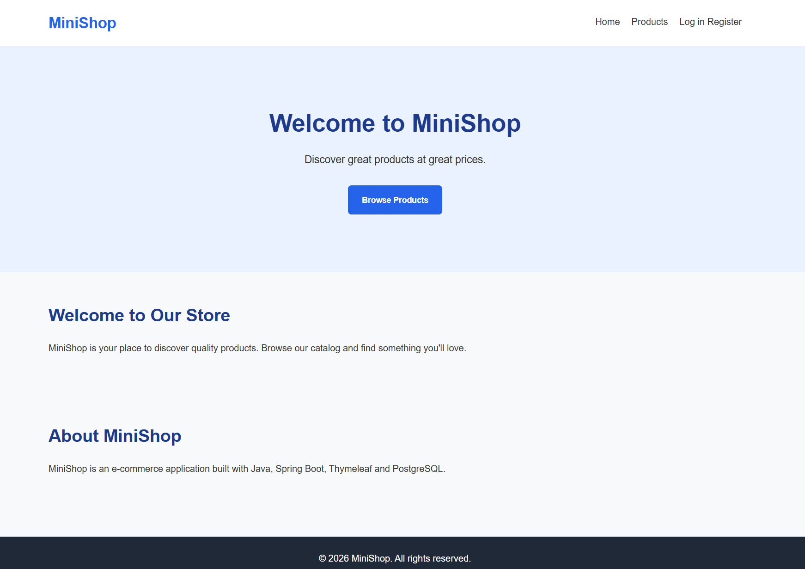
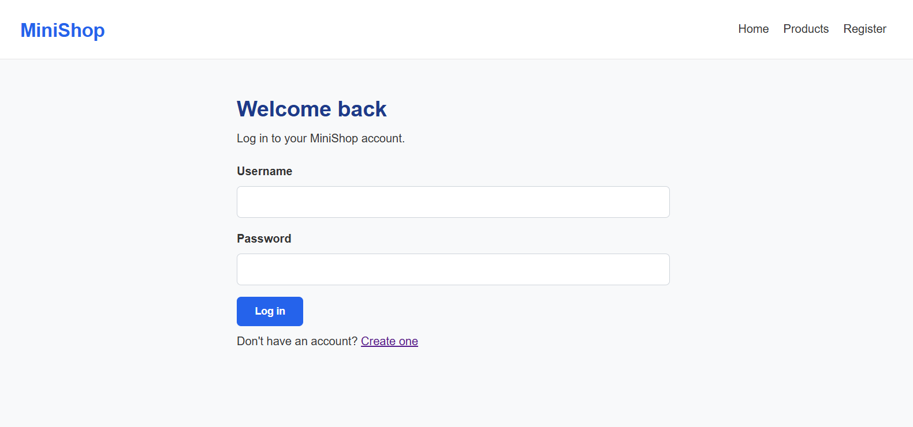
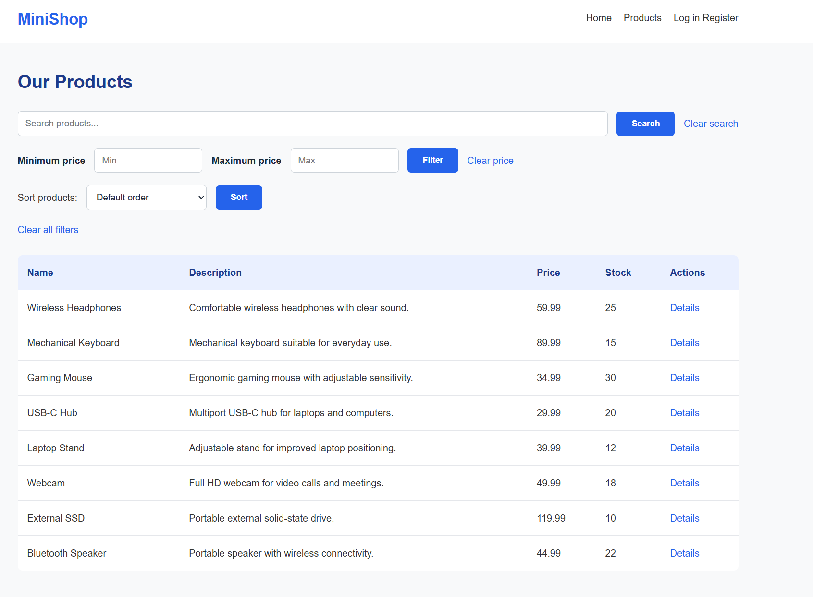

# MiniShop


MiniShop is a full-stack e-commerce web application developed using Java and Spring Boot. It provides product browsing, user authentication, product management, purchasing functionality, stock management, and order tracking.

The application supports two user roles: regular users and administrators. Regular users can browse products, purchase available items, and view their order history. Administrators can manage products and users, reset the product catalog, and monitor all customer orders.

---

## Screenshots

### Home Page



### Login Page



### Products Page



---

## Features

### Product Catalog

- Browse available products.
- View individual product details.
- Search products by name.
- Filter products by price.
- Sort products.
- Display product prices and available stock.
- Hide out-of-stock products from the public catalog.

### User Authentication and Management

- Register a new user account.
- Log in securely.
- Password hashing using Spring Security.
- Role-based access control.
- Separate permissions for administrators and regular users.
- Administrators can view and manage registered users.
- Prevent administrators from deleting their own account.
- Prevent deletion of the last administrator.

### Product Management

- Create new products.
- Edit existing products.
- Delete products.
- Reset the product catalog to predefined default products.
- Automatically initialize the default catalog when the database is empty.

### Purchasing and Order Management

- Purchase products in selected quantities.
- Validate available stock before purchasing.
- Automatically decrease stock after a successful purchase.
- Prevent purchases exceeding available stock.
- Prevent negative stock quantities.
- View personal order history.
- Administrators can view all customer orders.
- Preserve historical product names and purchase prices in order records.

### Database and Data Management

- PostgreSQL database integration.
- Persistent database storage using Docker volumes.
- Users and orders are connected through database relationships.
- Deleting a user also deletes their associated orders and order items.
- Resetting the product catalog preserves historical order information.

---

## Technology Stack

| Technology | Purpose |
|---|---|
| Java 21 | Programming language |
| Spring Boot 4.1.2 | Application framework |
| Spring MVC | Web application |
| Spring Data JPA | Database access |
| Hibernate | Object-relational mapping |
| Spring Security | Authentication and authorization |
| Thymeleaf | Server-side HTML rendering |
| PostgreSQL 17 | Relational database |
| HTML5 | Page structure |
| CSS3 | Styling |
| Maven | Build and dependency management |
| JUnit 5 | Automated testing |
| Mockito | Mocking and unit testing |
| Docker | Database containerization |
| Git and GitHub | Version control |
| GitHub Actions | Continuous Integration |

---

## Requirements

Before running the application, install:

- **Java Development Kit 21**
- **Apache Maven**
- **Docker Desktop**
- **Git**

Verify your installations using PowerShell:

```powershell
java -version
mvn -version
docker --version
git --version
```

Make sure Java reports version 21 and Docker Desktop is running.

---

# Installation and Setup

Follow these instructions to run MiniShop on a Windows computer.

## Step 1: Clone the Repository

Open PowerShell or the terminal in IntelliJ IDEA.

Navigate to the directory where you want to store the project.

Clone the repository:

```powershell
git clone https://github.com/Tomey-SNR/java-minishop.git
```

Navigate into the project directory:

```powershell
cd java-minishop
```

You should now be in the project root directory, where `pom.xml` is located.

## Step 2: Configure Environment Variables

MiniShop uses a `.env` file to store database settings and administrator credentials.

The actual `.env` file is excluded from Git because it contains local configuration and sensitive information.

The repository includes a `.env.example` file as a template.

### 2.1 Create the `.env` file

Run:

```powershell
Copy-Item .env.example .env
```

This creates a local `.env` file based on the example configuration.

### 2.2 Open the `.env` file

Run:

```powershell
notepad.exe .\.env
```

This opens the file in Windows Notepad.

### 2.3 Configure your credentials

Enter your own values:

```dotenv
DB_URL=jdbc:postgresql://localhost:5433/minishop
DB_USERNAME=minishop
DB_PASSWORD=choose_your_database_password

ADMIN_USERNAME=admin
ADMIN_EMAIL=admin@minishop.local
ADMIN_PASSWORD=choose_your_admin_password
```

Save the file and close Notepad.

### Environment Variables Explained

| Variable | Description |
|---|---|
| `DB_URL` | PostgreSQL database connection URL |
| `DB_USERNAME` | PostgreSQL database username |
| `DB_PASSWORD` | PostgreSQL database password |
| `ADMIN_USERNAME` | Initial administrator username |
| `ADMIN_EMAIL` | Initial administrator email |
| `ADMIN_PASSWORD` | Initial administrator password |

All six variables are required.

### Important: Database Password Configuration

You choose your own database password. It is not automatically generated by MiniShop or Docker.

Docker uses the value of `DB_PASSWORD` when initializing a new PostgreSQL database.

For example:

```dotenv
DB_PASSWORD=my_local_database_password
```

The same password must be supplied to PostgreSQL when creating the Docker container.

Spring Boot uses the same credentials to connect to PostgreSQL.

**Important:** PostgreSQL uses the password supplied during initial database initialization. Changing `DB_PASSWORD` in `.env` does not automatically change the password of an already initialized database.

### Security Notes

- Never commit your real `.env` file to GitHub.
- Only commit `.env.example` with placeholder values.
- Use different secure passwords for the database and administrator account.
- Do not reuse example passwords in a real deployment.

MiniShop validates the `.env` file during startup. If the file is missing or a required variable is empty, the application stops with an explanatory error message.

## Step 3: Start the PostgreSQL Database

MiniShop uses PostgreSQL 17 running inside a Docker container.

Make sure Docker Desktop is running.

### 3.1 Create the PostgreSQL container

For a fresh installation, run the following command in PowerShell:

```powershell
docker run --name minishop-postgres `
  -e POSTGRES_DB=minishop `
  -e POSTGRES_USER=minishop `
  -e POSTGRES_PASSWORD=your_database_password `
  -p 5433:5432 `
  -v minishop-postgres-data:/var/lib/postgresql/data `
  --restart unless-stopped `
  -d postgres:17
```

Replace `your_database_password` with the same password configured as `DB_PASSWORD` in your `.env` file.

This command:

- Downloads PostgreSQL 17 if it is not already available.
- Creates a database named `minishop`.
- Creates a database user named `minishop`.
- Configures the database password.
- Exposes PostgreSQL on port `5433`.
- Creates a persistent Docker volume for database data.
- Starts the container in the background.

### 3.2 Check the container

Run:

```powershell
docker ps
```

You should see a container named:

```text
minishop-postgres
```

Check its logs:

```powershell
docker logs minishop-postgres
```

### 3.3 Starting an existing container

If you have already created the container and stopped it, start it again with:

```powershell
docker start minishop-postgres
```

You do not need to create a new container every time you run MiniShop.

### Database Connection

The application connects to PostgreSQL using:

```text
Host: localhost
Port: 5433
Database: minishop
Username: minishop
```

The database password is the value configured in your `.env` file.

### Database Persistence

Docker uses a named volume called `minishop-postgres-data` to preserve database information.

Stopping or restarting the container does not normally delete stored data.

**Important:** Avoid removing the Docker volume unless you intentionally want to delete the database and its stored information.

## Step 4: Build the Application

Before starting MiniShop, compile and test the project using Maven:

```powershell
mvn clean install
```

This command:

1. Removes previous build output.
2. Compiles the source code.
3. Runs the automated tests.
4. Packages the application.
5. Verifies that the build completes successfully.

Wait until Maven reports:

```text
BUILD SUCCESS
```

## Step 5: Start MiniShop

Make sure the PostgreSQL container is running.

From the project root, execute:

```powershell
mvn spring-boot:run
```

Spring Boot will:

1. Load the application configuration.
2. Validate the `.env` file.
3. Connect to PostgreSQL.
4. Initialize the administrator account.
5. Initialize the default product catalog if the database is empty.
6. Start the web server.

When startup is successful, open the application in your browser:

**http://localhost:8080**

## Step 6: Log In as Administrator

Use the administrator credentials configured in your `.env` file:

```text
Username: value of ADMIN_USERNAME
Password: value of ADMIN_PASSWORD
```

The administrator can access:

- Product management.
- User management.
- Order management.
- Product catalog reset functionality.

The application also supports regular user registration through the registration page.

Register a regular account to explore the customer functionality.

---

# Running Automated Tests

MiniShop includes automated tests covering application functionality and business rules.

To execute the complete test suite, run:

```powershell
mvn clean test
```

The verified project version has **111 passing automated tests**.

The tests cover areas including:

- User registration and validation.
- Authentication and authorization.
- Product management.
- Product catalog initialization and reset.
- Purchasing and stock validation.
- Order creation and order history.
- Administrator functionality.
- User deletion and associated data cleanup.
- Controller and service behavior.
- Database integration.

A successful test execution should finish with:

```text
BUILD SUCCESS
```

---

# Continuous Integration – GitHub Actions

MiniShop uses GitHub Actions to automatically build and test the application.

The CI workflow is located at:

```text
.github/workflows/ci.yml
```

### Workflow Triggers

The workflow runs automatically when:

- Code is pushed to the `main` branch.
- A pull request targeting `main` is created or updated.

### CI Pipeline

The workflow performs the following steps:

1. Checks out the repository.
2. Sets up Java 21.
3. Starts a temporary PostgreSQL 17 service container.
4. Creates the required `.env` configuration using CI-specific test credentials.
5. Runs the complete Maven test suite.

The workflow executes:

```bash
mvn -B clean test
```

### CI Status

The workflow provides automatic feedback on GitHub.

- **Successful run:** All tests pass.
- **Failed run:** At least one test or build step fails.

The CI workflow uses its own temporary database and test credentials. It does not use the developer's local database or real administrator credentials.

---

# Stopping the Application

To stop the Spring Boot application, press:

```text
Ctrl + C
```

To stop the PostgreSQL container while preserving its database volume:

```powershell
docker stop minishop-postgres
```

To start it again later:

```powershell
docker start minishop-postgres
```

**Important:** Do not remove the persistent Docker volume unless you intentionally want to delete the stored database data.

---

# Troubleshooting

## Application Cannot Find the `.env` File

Make sure you created `.env` from `.env.example`:

```powershell
Copy-Item .env.example .env
```

Make sure the file is located in the project root, alongside `pom.xml`.

## Missing Environment Variable Error

Open `.env`:

```powershell
notepad.exe .\.env
```

Check that all six required variables are present and have non-empty values.

## Database Connection Error

Check that:

1. Docker Desktop is running.
2. The PostgreSQL container is running.
3. The database port is correctly configured.
4. The database username and password match your configuration.

Check the container:

```powershell
docker ps
```

View its logs:

```powershell
docker logs minishop-postgres
```

## Database Password Does Not Match

If PostgreSQL has already been initialized, changing `DB_PASSWORD` in `.env` alone will not update the existing PostgreSQL user's password.

Use the credentials already configured in the database, or intentionally update the PostgreSQL user's password to match the new configuration.

Do not delete the database volume just to change a password unless you are prepared to lose its stored data.

## Port 5433 Is Already in Use

Another application or PostgreSQL container may already be using port `5433`.

Check running containers:

```powershell
docker ps
```

Stop the conflicting container or configure a different host port and update `DB_URL` accordingly.

## Port 8080 Is Already in Use

Another application may already be using port 8080.

Stop the other application or configure MiniShop to use a different server port.

## Maven Build Fails

Check your Java version:

```powershell
java -version
```

Make sure JDK 21 is installed and configured correctly.

You can also try:

```powershell
mvn clean test
```

Read the first reported compilation or test error to identify the cause.

---

# Project Structure

The project follows a layered Spring Boot architecture.

```text
java-minishop/
│
├── .github/
│   └── workflows/
│       └── ci.yml
│
├── screenshots/
│   ├── home.png
│   ├── login.png
│   └── products.png
│
├── src/
│   ├── main/
│   │   ├── java/
│   │   │   └── com/codecool/minishop/
│   │   │       ├── config/
│   │   │       ├── controller/
│   │   │       ├── dto/
│   │   │       ├── model/
│   │   │       ├── repository/
│   │   │       └── service/
│   │   │
│   │   └── resources/
│   │       ├── static/
│   │       │   └── css/
│   │       ├── templates/
│   │       ├── META-INF/
│   │       └── application.properties
│   │
│   └── test/
│       └── java/
│
├── .env.example
├── .gitignore
├── pom.xml
└── README.md
```

### Architecture Overview

- **Controller layer:** Handles HTTP requests and responses.
- **Service layer:** Contains application logic and business rules.
- **Repository layer:** Handles database operations through Spring Data JPA.
- **Model layer:** Contains entities and domain objects.
- **DTO layer:** Transfers data between application layers and the web interface.
- **Config layer:** Contains application configuration and security settings.
- **Templates:** Contains Thymeleaf HTML pages.
- **Static resources:** Contains CSS and other frontend assets.

---

# Author

**Tomey SNR**

GitHub: [Tomey-SNR](https://github.com/Tomey-SNR)
